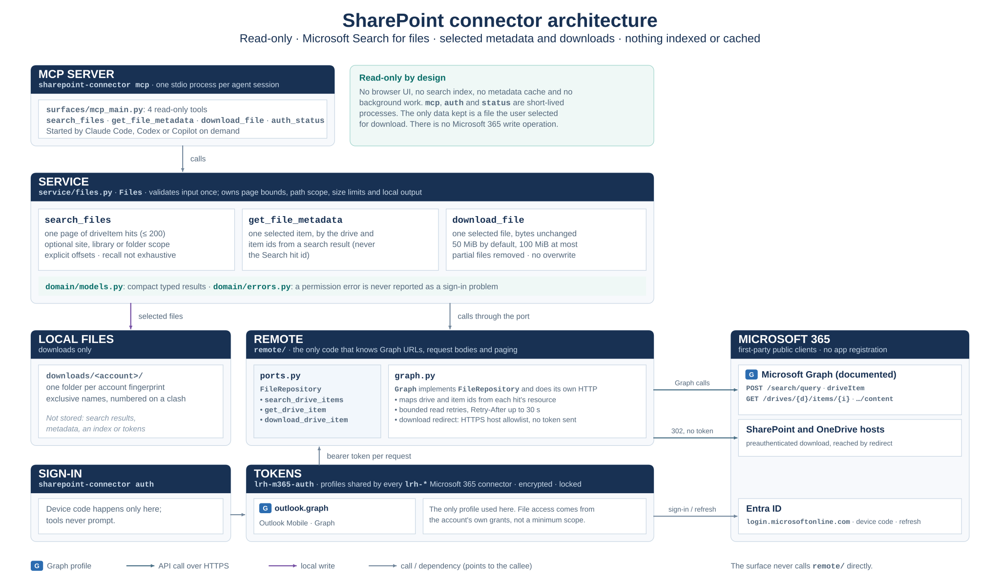

# Architecture

## Layers

This is a single-user local application with one user-facing surface, the MCP server.

The MCP surface owns tool names, schemas and MCP transport. It calls the service; it does not know
Graph URLs or map wire responses. Service methods validate public inputs and own decisions about
page bounds, path scope, file size and local output. The remote adapter implements the repository
port and alone knows Graph URLs, request bodies, continuation semantics and response mapping. The
composition root lazily builds one adapter and account-bound service set on first use.

Keeping a surface layer remains useful with one MCP surface: it isolates protocol contracts from
service decisions and remote APIs. There is no browser UI, SQLite store, search index or background
task. The only durable output is a file explicitly selected by the user for download, isolated into
a folder keyed by the active account fingerprint.

## Authentication and account binding

The connector uses lrh-m365-auth and the outlook.graph profile. It creates no duplicate MSAL client
or token cache. Every public service context lookup obtains a current token, checks stable
tenant/object identity, and rebuilds the account-bound service set after an account switch. Graph
requests acquire the current profile token. Download directories are account-fingerprinted. The
shared auth cache is encrypted by the library and used by Outlook, Teams and SharePoint.

The shared auth bootstrap includes six resource profiles. SharePoint consumes `outlook.graph` for
its configured Graph operations. `m365.search` is bootstrapped for Outlook calendar and Teams
message discovery; this connector does not use it, and it grants no SharePoint file permission.

A cached credential indicates only that OAuth state exists. Graph can still deny Search, metadata or
one selected file. Search and file permission errors remain separate from sign-in readiness.

## Graph adapter

Search POSTs one driveItem entity request to /v1.0/search/query. The mapper takes actual drive/item
references from each hit's resource and parentReference. It never maps the Search hitId into an item
ID. The service exposes Graph's explicit from/size paging and moreResultsAvailable flag, while
labeling total hits informational and recall non-exhaustive.

Metadata GETs /drives/{drive-id}/items/{item-id} with a bounded property selection. Download GETs the
same item's /content route. Graph's 302 target is checked against a narrow HTTPS host suffix
allowlist; subsequent preauthenticated requests omit Authorization. The response is streamed into
an exclusively created local file, with byte counting and partial-file deletion on failure.

The adapter retries read requests a bounded number of times for throttling and transient gateway
errors, respecting numeric or date-form Retry-After values up to 30 seconds. Search POST is a
read-only operation and is safe to retry. No Graph write adapter exists.

## CLI and shared service boundary

The CLI exposes auth, status and mcp commands. Authentication is explicit; starting the MCP process
does not launch a login flow. MCP tools call the same Files service methods as each other, keeping
input bounds and file behavior consistent. Offline status distinguishes a cached OAuth client
credential from a resource-specific Graph access-token expiry; `status --check` tests token
acquisition, not file-operation permission. Local downloads are the only product data retained by
this connector.

## Logging

Each `mcp` process writes its own file, `<data directory>/logs/<command>-<start time>-<process id>.log`,
rotated at midnight and kept seven days ([`logs.py`](../src/sharepoint_connector/logs.py), the same module in every
`lrh-*` connector). The MCP server logs to its file only, since stdout carries the protocol. A filter
redacts bearer tokens, credential headers, assigned secrets and secret query parameters; `httpx` and
`httpcore`, which log full request URLs, are held at WARNING. `SHAREPOINT_CONNECTOR_LOG_LEVEL` sets the level (default
INFO). Records carry operational timings, statuses and counts, never message or file content, search
terms, names, identifiers or tokens. The shared sign-in library logs through the same handlers.

## MCP tools

The stdio server exposes exactly these three tools. Authentication and status are CLI commands,
not MCP tools.

### Search and inspect

- `search_files(query, offset=0, page_size=25, scope_url=null)` — asks Microsoft Search for driveItem
  results. Page size is capped at 200. The response includes Graph resource IDs, name, available
  location/type/size/date metadata, webUrl, rank, summary, total when returned, more-results state
  and next_offset. Search snippets and names are untrusted text. Search does not download content.
- `get_file_metadata(drive_id, item_id)` — reads metadata for one selected item using the exact resource
  identifiers from a search result.

### Retrieve a file

- `download_file(drive_id, item_id, max_bytes=52428800)` — downloads one selected non-folder file.
  The default is 50 MiB; the hard maximum is 100 MiB. The response gives a local path for the agent
  to read with local file tools.

Microsoft Search hitId is not a driveItem ID. Use drive_id and item_id taken from the result's
resource object; results missing either ID can be opened by webUrl but cannot be hydrated by these
tools.

Example workflow:

1. Search for a narrow topic, such as annual budget draft.
2. Read the result snippet, location and dates. Request another page only when it could help.
3. Hydrate metadata for a promising result using its drive_id and item_id.
4. Download only the selected file if its contents are needed.

Search ranks matches; it is not exhaustive recall. An empty result can reflect indexing delay,
content-type limits, access rights, query syntax or scope constraints. Do not infer that a library
contains no matching file from one empty result. Microsoft Search does not promise a complete
organization-wide corpus outside files the signed-in account can access.

### Scope, paging and indexing

The optional scope_url adds a Graph KQL path constraint to the search query. Scoped queries accept
plain terms only, so a query cannot add KQL operators that broaden the scope. A rejected scoped
request is returned as an error; the connector never retries it without the path constraint. Use a
site, library or folder URL without query/fragment parameters. Scope behavior remains subject to
known-hit tests passed for representative OneDrive and shared SharePoint parent URLs in one
account. Other URL forms and tenants remain deployment-specific; a zero result is not proof the scope
contains no files.

Use next_offset only when more_results_available is true. The offset is explicit and stable for one
request, but Graph Search ranking and indexing can change between pages. Search returns files the
current account can access. It can match names and supported file content; it does not identify
which internal part matched, and snippets can be incomplete.

New or changed files may take time to appear in Microsoft Search. Graph does not provide an
indexing-completion signal or an exhaustive recall guarantee.

### Metadata and downloads

Metadata comes from GET /drives/{drive-id}/items/{item-id}; the exact route reference is returned
from resource.id and resource.parentReference.driveId. Metadata includes the Graph webUrl, name,
file type, size, dates and parent path when Graph returns them.

Downloads land in `<data directory>/downloads/<account fingerprint>/`. Files older than seven days,
in any account's folder, are removed when the next download uses the folder
([`service/localfiles.py`](../src/sharepoint_connector/service/localfiles.py), the same module as in the
Outlook and Teams connectors).

Downloads use GET /drives/{drive-id}/items/{item-id}/content. The connector streams bytes to the
local downloads directory, checks the configured maximum while receiving, rejects unsafe redirect
hosts, and does not forward the Graph bearer token to a preauthenticated download host. It keeps
the file bytes unchanged and does not extract document text. A failed or oversized transfer removes
the partial file. Existing files are not overwritten; a numeric suffix is added to a duplicate name.

Default Windows output:

~~~text
%LOCALAPPDATA%\lrh-sharepoint-connector\downloads\<account-fingerprint>\
~~~

Override the data root with SHAREPOINT_CONNECTOR_HOME. Downloads remain on disk for the user to
manage; uninstalling the connector does not delete them. They are separated by the account
fingerprint so a later shared-account switch does not return earlier downloads as current-account
data.
